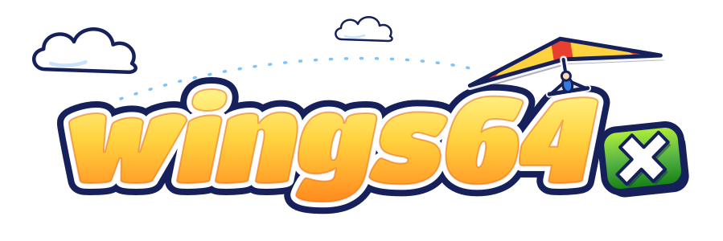

<p align="center">
  
</p>

<p align="center">
  <a href="https://github.com/TechProGabe/Wings64-X/actions/workflows/build.yml"></a>
  <a href="https://github.com/TechProGabe/Wings64-X/releases"></a>
  
  
  
  
</p>

Pilotwings 64, running natively on an original Xbox. No emulator: the game's own code, rebuilt for the Pentium III.

After getting it flying on the Dreamcast I wanted to see what the Xbox could do with it. The answer is a steady 60 fps, 720p, widescreen, and rumble when you crash. :)

## What it is

The Pilotwings 64 decompilation ([n64decomp/pw64](https://github.com/n64decomp/pw64)) built with [nxdk](https://github.com/XboxDev/nxdk) and LLVM 21. The game's N64 display lists are interpreted on the CPU and drawn by the Xbox's NV2A, and the N64's audio microcode is rewritten in C so the Xbox's sound chip can play the game's own music and effects. The game data comes from a ROM you supply, read at runtime the way the N64 read its cartridge. It targets a stock retail console with 64 MB of RAM.

What you get on top of the N64 game:

- 60 fps, with the game's per-frame timing fixed so it plays the same as at 30 (a 30 fps option is there too)
- 480i, 480p and 720p, whatever your dashboard allows
- 16:9 widescreen in flight that shows more of the world instead of stretching it, with the gauges moved out to the edges
- Rumble when you crash
- A Sharp texture filter if you like crisp pixels
- A one-press complete save if you just want to fly around with everything unlocked
- Saves in the same EEPROM format Project64 and Mupen64Plus use

## What you need

- An original Xbox that runs homebrew (softmod or modchip). A stock 64 MB console is fine.
- A way to copy files to it. Most dashboards (UnleashX, XBMC4Gamers, EvolutionX) have an FTP server built in.
- Your own **Pilotwings 64 (US)** ROM, dumped from your cartridge. It's 8 MB with game code `NPWE`. Any byte order and any file name work (`.z64`, `.n64`, `.v64`, `.rom` or `.bin`). The port checks its SHA-1 at boot and won't run anything else. The Japanese and European releases get a message telling you so.
- A controller.

Nothing from Nintendo ships with this. You need your own copy of the game.

## Install

Grab the newest `Wings64-X-<version>.zip` from [Releases](../../releases) and unzip it.

**Hard drive** (easiest, and it loads fastest):

1. Put your ROM in the `Wings64-X` folder, next to `default.xbe`.
2. Connect to your Xbox with an FTP client like FileZilla. The dashboard shows the IP address, and the login on most dashboards is `xbox` / `xbox`.
3. Copy the whole `Wings64-X` folder to `E:\Games\` (or wherever your dashboard looks for games).
4. Launch it from the dashboard.

If it can't find the ROM, you get a card that says which folder it looked in and which extensions it accepts.

**Burned disc:** `tools/make-xiso` packs the game, the icon and your ROM into one disc image.

```sh
tools/make-xiso Wings64-X "Pilotwings 64 (U).z64" Wings64-X.iso
```

It needs [xdvdfs](https://github.com/antangelo/xdvdfs/releases) or extract-xiso on your PATH. Burn the ISO slowly and start it from the dashboard. Some Xbox drives just don't like burned discs, so if yours won't read it, use the hard drive.

**xemu:** load the ISO with Machine > Load Disc and give xemu 64 MB of memory. It's slower than a real Xbox, and the console is the real test.

**Updating:** copy the new `default.xbe` and `default.tbn` over the old ones. Your saves and settings stay put.

## Settings

Press **Back** on the title screen, or pick **Option > Port settings**. There are three pages. Up and down pick a row, left and right (or A) change it, and B goes back. The line under the rows explains whatever the cursor is on.

| page | row | what it does |
|---|---|---|
| Video | Resolution `*` | Auto, 480i, 480p or 720p. It shows what you'll actually get, like `720p > 480i`, and tells you when the dashboard has a mode switched off |
| Video | Widescreen | Off, On or Auto (the default). Auto is 16:9 at 720p and follows the dashboard at 480. It's for flight only, the menus stay 4:3 |
| Video | Texture filter | N64 (the game's own look) or Sharp (crisp square pixels) |
| Video | FPS counter | Frames per second in the top left corner |
| Video | Frame rate | 60 (the default) or 30, like the N64 |
| Video | Apply and restart | Restarts to apply the rows marked `*` |
| Controls | Stick dead zone | 0 to 60 % (default 20). A live readout shows how far your stick is tilted, so you can pick a value that suits your controller |
| Controls | Rumble | Shakes the controller when you crash |
| System | Screenshots | Off by default. When it's on, **Back** during play saves a picture to `E:\UDATA\57580001\`. The game stalls for a moment while it saves, longer at 720p |
| System | Complete save | Writes a save with every event at full points (all gold, everything unlocked) into **File 2**. If File 2 already has a save, it asks you to press A again. File 1 is never touched |

Everything except Resolution applies right away. The settings live in `E:\UDATA\57580001\settings.ini`, which you can edit over FTP. Delete it to get the defaults back.

## Controls

| Xbox | N64 |
|---|---|
| Left stick | Control stick |
| A | A |
| X | B |
| D-pad | C buttons (the camera views) |
| Right stick | C buttons too |
| Left trigger | Z |
| Right trigger | R |
| Start | Start |
| Back on the title screen | Port settings |
| L + R + Back + Black | Quit to the dashboard |
| L + R + Back + White | Restart the game |

L and R in the combos are the triggers, pressed all the way. The combos work everywhere, even on a screen that has stopped responding.

## Video

Your dashboard decides what your TV and cables can handle, and the port never goes past it.

- **480i** works on everything, composite included.
- **480p** needs an HDTV or VGA pack and 480p turned on in the dashboard.
- **720p** needs an HDTV or VGA pack and 720p turned on in the dashboard. It's always 16:9.

The first time you pick 720p, the game asks you to press A to keep it. If your TV goes black and you can't see the prompt, just wait 15 seconds and it comes back in 480i on its own. You can also hold **Back** while the game starts to force 480i.

## Saves

Saves go to `E:\UDATA\57580001\pilotwings64.eep`. It's the cartridge's 16 Kbit EEPROM in the byte order Project64 and Mupen64Plus use, so moving a save to or from an emulator should just work. Saves are written to a temporary file first and swapped in, so a failed write leaves your old save alone.

## If something breaks

The logs are in `E:\UDATA\57580001\`: `boot.log` for the last start, `boot_prev.log` for the one before, `crash.log` if it crashed, and `lastexit.txt` for how the last run ended. Leave the game with the quit combo or Option > Exit to dashboard so the log gets written out, then attach those files (and a photo if there was an error on screen) when you open an issue.

**ROM refused?** The card says why: wrong size, not an N64 ROM, a different game, or a bad dump. A bad dump shows its SHA-1 so you can compare it yourself.

**Black screen after changing the resolution?** Wait 15 seconds, or hold Back while starting the game.

## Building it

nxdk and LLVM 21, natively on Windows with MSYS2 or in Docker:

```sh
tools/xbox/fetch_decomp.sh     # the decomp at its pinned commit, with the port's patches
tools/xbox/msys/build.sh       # Windows (MSYS2)
tools/xbox/docker/build.sh     # Docker (Linux, macOS, Windows)
```

Both write `build-xbox/xbe/default.xbe` and `default.tbn`. [docs/](docs/README.md) has the rest, starting with [docs/toolchain.md](docs/toolchain.md).

## Thanks

This port stands on a lot of other people's work:

- **[n64decomp/pw64](https://github.com/n64decomp/pw64)**, the decompilation. The whole game, as C. Without it there is no port.
- **[Birdman64](https://github.com/NoahVl/Birdman64)** by NoahVl (MIT), a PC port of the same decomp. Its N64 structures, audio loader, 60 fps fixes and widescreen approach are all in here.
- **[wings64-dc](https://github.com/TechProGabe/wings64-dc)**, the Dreamcast port this one grew out of: its patches, the display list interpreter and the settings menu.
- **[Melee-X](https://github.com/TechProGabe/Melee-X)**, the Xbox port of Melee: the splash, the video modes, the controller combos and the release tooling.
- **[OpenCrossing-Xbox](https://github.com/GabeConway/OpenCrossing-Xbox)** (MIT), for the Xbox audio, crash reporting and timer code.
- **[nxdk](https://github.com/XboxDev/nxdk)**, the open Xbox dev kit everything runs on, **[xemu](https://xemu.app)**, which does a lot of the testing, and **[xdvdfs](https://github.com/antangelo/xdvdfs)**, which packs the discs.

This repo has no game assets, no ROM data and no Nintendo code, so please don't ask for ROMs. Pilotwings 64 belongs to Nintendo and Paradigm, and Xbox is Microsoft's. This is an unofficial fan project, not affiliated with either. Licensing is in [LICENSE.md](LICENSE.md).

AI tools (Claude) were used in developing this port.
